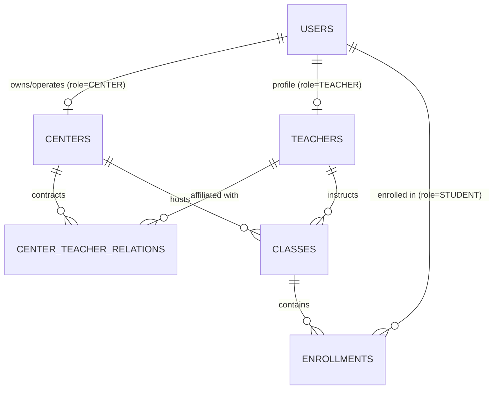
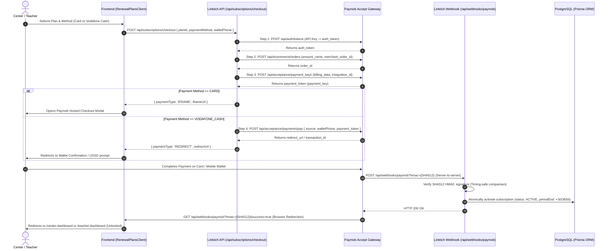

# Linktich - B2B2C Tutoring Platform (Egypt)

## Architectural Overview & Database Setup (Task 1)

**Linktich** is an enterprise-grade B2B2C SaaS platform built to unify the private tutoring and educational center ecosystem in Egypt.

### Core Monetization & Actors
1. **Tutoring Centers (Centers)**: Physical or regional educational centers (e.g., in Cairo, Giza, Alexandria) paying a monthly or annual SaaS subscription for administrative capabilities, room allocation, teacher management, and automated student enrollment tracking.
2. **Teachers**: Independent educators or center-affiliated teachers paying a recurring SaaS subscription to run class groups (مجموعات), monitor attendance, track student payment statuses, and communicate with students.
3. **Students**: Free access for students to discover classes, register, monitor schedules, and track payment/attendance records.

---

## Technology Stack

- **Framework**: Next.js 14 (App Router) + TypeScript
- **Database & ORM**: PostgreSQL (via Supabase or standalone Postgres) + Prisma ORM
- **Runtime Validation**: Zod (with Egyptian phone validation `+201[0125]XXXXXXXX`)
- **Styling Configuration**: Tailwind CSS (configured for RTL Arabic & LTR English)
- **Monetization Readiness**: Paymob / Fawry webhook integration models for recurring SaaS payments (EGP).

---

## Database Architecture

### Entity Relationship Diagram (ERD)



### Tables Overview

| Table | Primary Key | Key Foreign Keys & Constraints | Description |
| :--- | :--- | :--- | :--- |
| `users` | `id` (UUID) | Unique `email`, indexed `phone`, `role` enum | System accounts across ADMIN, CENTER, TEACHER, and STUDENT. |
| `centers` | `id` (UUID) | Unique `owner_id` -> `users.id` | Educational centers with recurring SaaS subscriptions. |
| `teachers` | `id` (UUID) | Unique `user_id` -> `users.id` | Teachers with subject specialty and recurring SaaS subscriptions. |
| `center_teacher_relations`| `id` (UUID) | Composite Unique `(center_id, teacher_id)` | Many-to-Many affiliation tracking status & revenue split. |
| `classes` | `id` (UUID) | `center_id` -> `centers.id`, `teacher_id` -> `teachers.id` | Educational groups with JSONB schedule, price (EGP), and capacity. |
| `enrollments` | `id` (UUID) | Composite Unique `(student_id, class_id)` | Student participation with payment status and attendance tracking. |

---

## Project Folder Structure

```
linktich/
├── .env.example                               # Environment variable templates
├── .gitignore                                 # Git ignore patterns
├── next.config.mjs                            # Next.js 14 compiler & runtime configuration
├── package.json                               # Dependencies & scripts
├── postcss.config.js                          # PostCSS plugins
├── README.md                                  # Architectural documentation
├── tailwind.config.ts                         # Tailwind CSS design system config
├── tsconfig.json                              # TypeScript strict configuration
│
├── prisma/
│   ├── schema.prisma                          # Prisma ORM schema & relations
│   └── seed.ts                                # Test data seeder for Egyptian context
│
├── supabase/
│   └── migrations/
│       └── 20261027000000_init_linktich_schema.sql # Direct PostgreSQL DDL, indexes, triggers & RLS
│
└── src/
    ├── app/
    │   ├── api/
    │   │   ├── classes/
    │   │   │   └── route.ts                   # Class management API
    │   │   ├── enrollments/
    │   │   │   └── route.ts                   # Student enrollment API
    │   │   └── subscriptions/
    │   │       └── webhook/
    │   │           └── route.ts               # Paymob/Fawry recurring SaaS webhook handler
    │   ├── layout.tsx                         # Next.js Root Layout (RTL-ready)
    │   └── page.tsx                           # Root page placeholder (no UI)
    │
    ├── config/
    │   └── plans.ts                           # SaaS pricing tiers & limits for Centers & Teachers
    │
    ├── lib/
    │   ├── prisma.ts                          # Singleton Prisma client instance
    │   └── validations/
    │       └── schema.ts                      # Zod validation schemas with Egyptian phone support
    │
    ├── services/                              # Encapsulated domain business logic
    │   ├── centerService.ts
    │   ├── classService.ts
    │   ├── enrollmentService.ts
    │   └── subscriptionService.ts
    │
    └── types/
        └── database.ts                        # TypeScript interfaces & DTO definitions
```

---

## Phase 2: Authentication & Role-Based Access Control (RBAC)

### Access Control Matrix

| Role | Permitted Dashboards | Redirect After Login | Registration Details |
| :--- | :--- | :--- | :--- |
| **CENTER** | `/center-dashboard` | `/center-dashboard` | Name, Email, Egyptian Phone, Password, Center Name, Location |
| **TEACHER** | `/teacher-dashboard` | `/teacher-dashboard` | Name, Email, Egyptian Phone, Password, Subject, Bio |
| **STUDENT** | `/student-dashboard` | `/student-dashboard` | Name, Email, Egyptian Phone, Password (Free Access) |
| **ADMIN** | All Dashboards | `/center-dashboard` | Internal Platform Management |

### Middleware Protection Logic
- **Unauthenticated requests** attempting to visit protected dashboards (`/center-dashboard`, `/teacher-dashboard`, `/student-dashboard`) are intercepted and redirected to `/login?callbackUrl=...`.
- **Role Boundary Violations** (e.g. A `STUDENT` attempting to access `/teacher-dashboard` or `/center-dashboard`) are automatically blocked at the Next.js Edge layer and redirected to their permitted dashboard (`/student-dashboard`).
- **Authenticated Sessions** attempting to visit `/login` or `/signup` are redirected straight to their respective role dashboard.

---

## Phase 3: Core Business Logic (Centers, Teachers & Students)

### 1. Center-Teacher Affiliation & Join Requests
- **Join Requests API**: `POST /api/center/teachers` allows Centers to invite instructors or accept affiliation requests, specifying an optional commission cut (e.g., 20%).
- **Affiliation Management UI**: [`TeacherAffiliationManager.tsx`](file:///C:/Users/user/.gemini/antigravity/scratch/linktich/src/components/center/TeacherAffiliationManager.tsx) provides a dashboard tab to review active instructors, accept pending invitations, or search discoverable teachers across Egypt.
- **Teacher Perspective API**: `GET /api/teacher/affiliations` & `PATCH /api/teacher/affiliations` allows teachers to view requests from centers and accept/decline.

### 2. Class Scheduling & Course Creation
- **Course Creation API**: `POST /api/classes` enforces that an instructor must have an active affiliation with the center before a class can be scheduled.
- **Class Creation UI**: [`CreateClassModal.tsx`](file:///C:/Users/user/.gemini/antigravity/scratch/linktich/src/components/center/CreateClassModal.tsx) allows centers to configure the group name, select an active instructor, build multi-day schedules (e.g. Sun & Wed), set tuition price in EGP, and select billing cycles (`MONTHLY` vs `PER_SESSION`).
- **Live Roster**: [`CenterClassesList.tsx`](file:///C:/Users/user/.gemini/antigravity/scratch/linktich/src/components/center/CenterClassesList.tsx) displays live class rosters, assigned teachers, and capacity ratios.

### 3. Student Discovery & Class Enrollment
- **Catalog Browsing API**: `GET /api/classes?browse=true&search=...` surfaces active classes across all tutoring centers with real-time capacity and student-specific enrollment status.
- **Student Enrollment API**: `POST /api/enrollments` atomically links a student to a class group with validation against duplicate enrollments and room capacity limits.
- **Student Portal UI**: [`StudentDashboardClient.tsx`](file:///C:/Users/user/.gemini/antigravity/scratch/linktich/src/components/student/StudentDashboardClient.tsx), [`BrowseClasses.tsx`](file:///C:/Users/user/.gemini/antigravity/scratch/linktich/src/components/student/BrowseClasses.tsx), and [`MyEnrollmentsList.tsx`](file:///C:/Users/user/.gemini/antigravity/scratch/linktich/src/components/student/MyEnrollmentsList.tsx) allow students to browse classes by subject/location, enroll with a single click, and view their weekly schedule.

---

## Phase 4: SaaS Subscription Model (Monetization & Gate)

### 1. Subscription Gate & Access Control
- **Server-Side Gate ([`src/lib/subscriptionGate.ts`](file:///C:/Users/user/.gemini/antigravity/scratch/linktich/src/lib/subscriptionGate.ts))**:
  - `requireActiveSubscription()` checks real-time database subscription status for Centers and Teachers.
  - If `subscriptionStatus === 'EXPIRED'` or `subscriptionCurrentPeriodEnd <= now()`, locks the dashboard and redirects to `/renew-subscription`.
  - **Exemptions**: Students have 100% free lifetime access; Admins have bypass permissions.
- **Middleware Guard ([`src/middleware.ts`](file:///C:/Users/user/.gemini/antigravity/scratch/linktich/src/middleware.ts))**:
  - Intercepts requests to `/renew-subscription` and routes unauthenticated users to `/login`.
  - Automatically redirects students away from `/renew-subscription` directly to `/student-dashboard`.

### 2. Renewal UI & Payment Simulation
- **Renewal Page ([`src/app/renew-subscription/page.tsx`](file:///C:/Users/user/.gemini/antigravity/scratch/linktich/src/app/renew-subscription/page.tsx))**:
  - Displays locked status, entity name, and reason for renewal.
  - Interactive billing interval toggle (Monthly vs Annual with 2 months free).
  - Role-specific plan cards: Center Starter (799 EGP), Center Pro (1,599 EGP), Teacher Solo (299 EGP), Teacher Pro (599 EGP).
  - Egyptian payment gateway options: Credit/Debit Card, Mobile Wallet (Vodafone Cash, Orange, WE), and Fawry Pay.
- **Checkout API ([`src/app/api/subscriptions/checkout/route.ts`](file:///C:/Users/user/.gemini/antigravity/scratch/linktich/src/app/api/subscriptions/checkout/route.ts))**:
  - Simulates Paymob / Fawry gateway processing with unique transaction reference (`PAYMOB_EGY_...`).
  - Sets `subscriptionStatus = 'ACTIVE'`, updates the plan, sets `subscriptionCurrentPeriodEnd` (+30 or +365 days), and returns an automatic redirect to unlock the dashboard.

### 3. Expiration Checker (Cron Job)
- **Cron API Route ([`src/app/api/cron/check-subscriptions/route.ts`](file:///C:/Users/user/.gemini/antigravity/scratch/linktich/src/app/api/cron/check-subscriptions/route.ts))**:
  - Protected endpoint (supports `Bearer ${CRON_SECRET}`) designed for Vercel Cron or GitHub Actions.
  - Updates all active subscriptions whose `subscriptionCurrentPeriodEnd` has passed to `EXPIRED`.
- **Standalone Script ([`scripts/check-subscriptions.ts`](file:///C:/Users/user/.gemini/antigravity/scratch/linktich/scripts/check-subscriptions.ts))**:
  - Can be run in standard cron jobs: `npx ts-node scripts/check-subscriptions.ts`.

---

## Phase 5: Daily Operations & Analytics

### 1. Attendance & Student Session Payments
- **Session Attendance Model**: `session_attendances` tracks attendance per session date (`PRESENT`, `ABSENT`, `LATE`, `EXCUSED`) along with session payment collection (`is_paid`, `amount_paid`).
- **Batch Attendance API**: `POST /api/classes/[classId]/attendance` saves attendance and payment changes in an atomic transaction and keeps master enrollments synchronized.
- **Roster & Attendance Modal ([`ClassRosterAttendanceModal.tsx`](file:///C:/Users/user/.gemini/antigravity/scratch/linktich/src/components/operations/ClassRosterAttendanceModal.tsx))**:
  - Interactive table with single-click `[Present]` / `[Absent]` and `[Paid]` / `[Unpaid]` toggles.
  - Direct WhatsApp links (`https://wa.me/...`) for student parent communication.
  - Quick action shortcuts: *"Mark All Present"* and *"Mark All Paid"*.

### 2. Center-Teacher Revenue Split Engine
- **Commission Split Logic**: Calculated from the agreed percentage in `CenterTeacherRelation.commissionRate` (e.g., Center 20% / Teacher 80%):
  $$\text{Gross Revenue} = \text{Paid Students} \times \text{Class Price (EGP)}$$
  $$\text{Center Share} = \text{Gross Revenue} \times \frac{\text{Center Commission \%}}{100}$$
  $$\text{Teacher Share} = \text{Gross Revenue} \times \frac{100 - \text{Center Commission \%}}{100}$$
  $$\text{Uncollected Tuition} = \text{Unpaid Students} \times \text{Class Price (EGP)}$$
- **Roster Analytics Panel**: Real-time summary displaying Gross Collected, Center Share, Teacher Share, and Uncollected Revenue.

### 3. Dashboard Analytics & Performance Charts
- **Analytics Overview API**: `GET /api/analytics/overview` provides metrics for Center Owners and Instructors.
- **Visual Analytics Component ([`DashboardAnalyticsSummary.tsx`](file:///C:/Users/user/.gemini/antigravity/scratch/linktich/src/components/analytics/DashboardAnalyticsSummary.tsx))**:
  - Stat cards: Total Active Students, Total Revenue This Month (EGP), Center/Teacher Earnings, and Attendance Rate.
  - Interactive Distribution Bar visualizing the Center facility cut vs Teacher earnings.
  - Performance list per class with collection progress bars and direct access to rosters.

---

## Phase 6: UI/UX & Theming (Dark Visual Theme & shadcn/ui)

### 1. Visual Theme & Color Palette
- **Background**: Very Dark / Rich Black (`#0A0A0F`)
- **Card Surfaces**: Dark Glassmorphism (`#12121A`, `#181824`) with `border-white/10` and `shadow-glass`
- **Primary Accent**: Electric Indigo (`#4A00E0`, hover: `#5E17EB`, `shadow-indigo`)
- **Secondary Accent**: Bright Cyan (`#00D4FF`, hover: `#38BDF8`, `shadow-cyan`)
- **Highlights**: Subtle Gold (`#FFD700`, `glow-gold`) for premium SaaS badges (like "Pro" subscriptions)

### 2. shadcn/ui Component Library
- **Card**: [`src/components/ui/card.tsx`](file:///C:/Users/user/.gemini/antigravity/scratch/linktich/src/components/ui/card.tsx)
- **Button**: [`src/components/ui/button.tsx`](file:///C:/Users/user/.gemini/antigravity/scratch/linktich/src/components/ui/button.tsx) (variants: `primary`, `secondary`, `gold`, `outline`, `ghost`, `destructive`)
- **Badge**: [`src/components/ui/badge.tsx`](file:///C:/Users/user/.gemini/antigravity/scratch/linktich/src/components/ui/badge.tsx) (variants: `default`, `cyan`, `gold`, `success`, `destructive`, `outline`)
- **Input**: [`src/components/ui/input.tsx`](file:///C:/Users/user/.gemini/antigravity/scratch/linktich/src/components/ui/input.tsx)
- **Table**: [`src/components/ui/table.tsx`](file:///C:/Users/user/.gemini/antigravity/scratch/linktich/src/components/ui/table.tsx)
- **Utility**: [`src/lib/utils.ts`](file:///C:/Users/user/.gemini/antigravity/scratch/linktich/src/lib/utils.ts) (`cn` helper)

### 3. RTL Arabic & Responsive Architecture
- Native Right-to-Left (`dir="rtl"`) layout integration with Google Fonts (`Cairo` and `Inter`) in [`src/app/layout.tsx`](file:///C:/Users/user/.gemini/antigravity/scratch/linktich/src/app/layout.tsx).
- Complete refactoring of Center Dashboard ([`src/app/center-dashboard/page.tsx`](file:///C:/Users/user/.gemini/antigravity/scratch/linktich/src/app/center-dashboard/page.tsx)), Teacher Dashboard ([`src/app/teacher-dashboard/page.tsx`](file:///C:/Users/user/.gemini/antigravity/scratch/linktich/src/app/teacher-dashboard/page.tsx)), and Student Dashboard ([`src/app/student-dashboard/page.tsx`](file:///C:/Users/user/.gemini/antigravity/scratch/linktich/src/app/student-dashboard/page.tsx)).

---

## Phase 7: The B2B2C Landing Page (`src/app/page.tsx`)

### 1. High-Converting Landing Page Sections
- **Hero Section**:
  - Main Headline in Arabic: *"أتمتة كاملة لإدارة سنترك التعليمي ومضاعفة أرباح الحصص"*
  - Two Core CTAs:
    - **'سجل كصاحب سنتر' (Register as Center)**: Electric Indigo primary button leading to `/signup?role=CENTER`.
    - **'سجل كمعلم' (Register as Teacher)**: Bright Cyan secondary button leading to `/signup?role=TEACHER`.
  - Social Proof / Trust Indicators: 500+ Egyptian centers & teachers, Vodafone Cash / Meeza / Fawry integration.
  - Interactive Glassmorphism Dashboard Preview Mockup showing real-time stats and automated revenue split calculations.
- **Features Section**:
  1. **QR Attendance (تسجيل الحضور بالباركود والواتساب)**: Instant check-ins with automatic WhatsApp notifications to parents.
  2. **Automated Revenue Splits (حساب نسب الأرباح تلقائياً)**: Automated commission split engine matching center-teacher agreements.
  3. **Multi-Center Affiliation (التعاقد والعمل في أكثر من سنتر)**: Unified teacher groups across Cairo, Giza, and Alexandria, with direct invitation workflows for centers.
- **Dynamic Pricing Section**:
  - Dynamically renders plans from [`src/config/plans.ts`](file:///C:/Users/user/.gemini/antigravity/scratch/linktich/src/config/plans.ts).
  - Center Plans vs Teacher Plans switcher.
  - Monthly vs Annual toggle (with 2 months free / 20% discount highlight).
- **Footer**:
  - Platform links, Egyptian payment methods, WhatsApp customer support contact, and legal links.

---

## Phase 8: Real Payment Gateway Integration (Paymob Accept)

### 1. Egyptian Paymob Architecture & Flow

Linktich is integrated with **Paymob Accept**, the leading payment aggregator in Egypt, enabling Centers and Teachers to pay recurring SaaS subscriptions in Egyptian Pounds (EGP) via **Bank Cards** (Visa, Mastercard, Meeza) and **Mobile Wallets** (Vodafone Cash, Orange Money, WE Pay, Etisalat Cash).



### 2. Paymob Integration Files

- **API Helper Utility**: [`src/lib/paymob.ts`](file:///C:/Users/user/.gemini/antigravity/scratch/linktich/src/lib/paymob.ts)
  - `authenticatePaymob()`: Obtains 1-hour authentication token.
  - `createPaymobOrder()`: Registers SaaS order with amount in Egyptian cents (EGP * 100) and encodes context in `merchant_order_id`.
  - `generatePaymentKey()`: Requests transaction key with sanitized billing data and payment integration ID.
  - `initiateWalletPayment()`: Triggers Vodafone Cash mobile wallet payment.
  - `buildCardIframeUrl()`: Constructs hosted Paymob checkout iframe URL.
  - `calculatePaymobHMAC()` & `verifyPaymobHMAC()`: Generates and verifies SHA512 HMAC signatures using `crypto.timingSafeEqual`.
  - `encodeMerchantOrderId()` & `decodeMerchantOrderId()`: Bidirectional encoding of `(role, entityId, planId, interval, timestamp)`.

- **Checkout API Endpoint**: [`src/app/api/subscriptions/checkout/route.ts`](file:///C:/Users/user/.gemini/antigravity/scratch/linktich/src/app/api/subscriptions/checkout/route.ts)
  - Validates authenticated user role (`CENTER` or `TEACHER`).
  - Verifies requested plan against SaaS pricing catalog.
  - Executes Paymob 3-step flow (or 4-step for Vodafone Cash).
  - Returns `iframeUrl` for cards or `redirectUrl` for mobile wallets.

- **Transaction Webhook & Callback Endpoint**: [`src/app/api/webhooks/paymob/route.ts`](file:///C:/Users/user/.gemini/antigravity/scratch/linktich/src/app/api/webhooks/paymob/route.ts)
  - **`POST` Handler**: Receives asynchronous transaction callbacks from Paymob server-to-server.
  - **`GET` Handler**: Receives browser redirection callbacks and routes the user back to their dashboard.
  - **HMAC Verification**: Recomputes SHA-512 over 20 Paymob transaction fields in strict alphabetical order:
    1. `amount_cents` 2. `created_at` 3. `currency` 4. `error_occured` 5. `has_parent_transaction` 6. `id` 7. `integration_id` 8. `is_3d_secure` 9. `is_auth` 10. `is_capture` 11. `is_refunded` 12. `is_standalone_payment` 13. `is_voided` 14. `order.id` 15. `owner` 16. `pending` 17. `source_data.pan` 18. `source_data.sub_type` 19. `source_data.type` 20. `success`.
  - **Atomic Activation**: Calls [`SubscriptionService.activateSubscription`](file:///C:/Users/user/.gemini/antigravity/scratch/linktich/src/services/subscriptionService.ts) to set `subscriptionStatus = ACTIVE` and extends period end.

- **Frontend Renewal & Checkout Component**: [`src/components/subscription/RenewalPlansClient.tsx`](file:///C:/Users/user/.gemini/antigravity/scratch/linktich/src/components/subscription/RenewalPlansClient.tsx)
  - Embedded Paymob iframe dialog for Card payments (Visa/Mastercard/Meeza).
  - Egyptian phone input validation (`01[0125]XXXXXXXX`) for Vodafone Cash.
  - Automatic redirection on wallet transactions.

- **Paymob Test Suite**: [`scripts/test-paymob.js`](file:///C:/Users/user/.gemini/antigravity/scratch/linktich/scripts/test-paymob.js)
  - Unit tests for HMAC verification, tamper detection, query parameter parsing, and bidirectional order ID encode/decode.
  - Run via: `node scripts/test-paymob.js`.

---

## Quick Setup Instructions

1. **Install Dependencies**:
   ```bash
   npm install
   ```

2. **Configure Environment Variables**:
   ```bash
   cp .env.example .env
   # Update DATABASE_URL with your PostgreSQL / Supabase connection string
   ```

3. **Deploy Schema**:
   ```bash
   # Via Prisma
   npx prisma db push
   # Or via migrations
   npx prisma migrate dev --name init
   ```

4. **Seed Sample Data**:
   ```bash
   npm run db:seed
   ```
